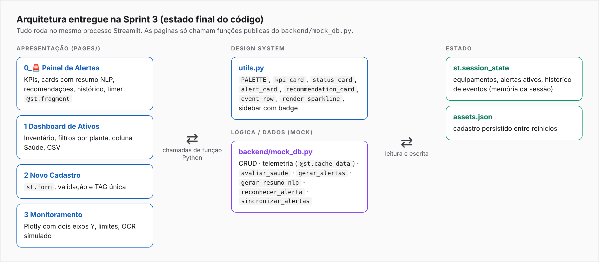
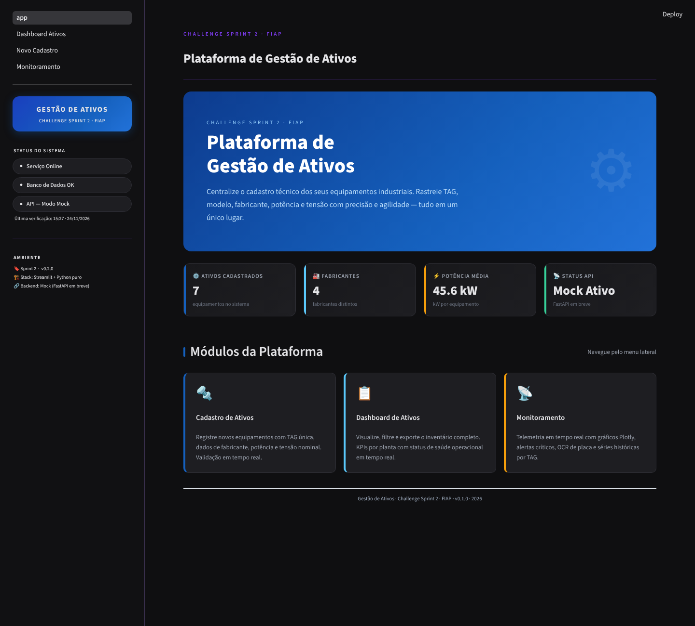
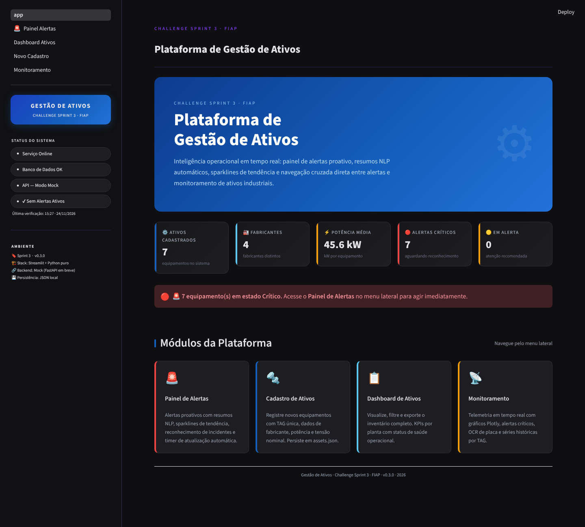
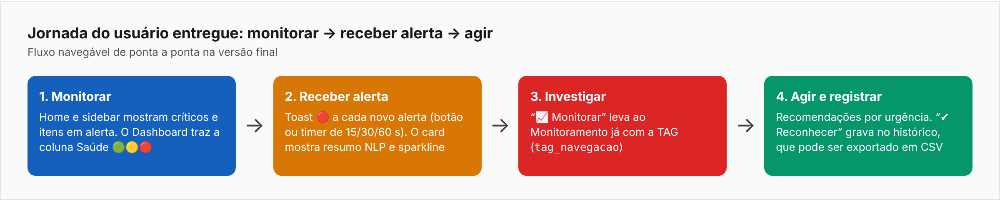
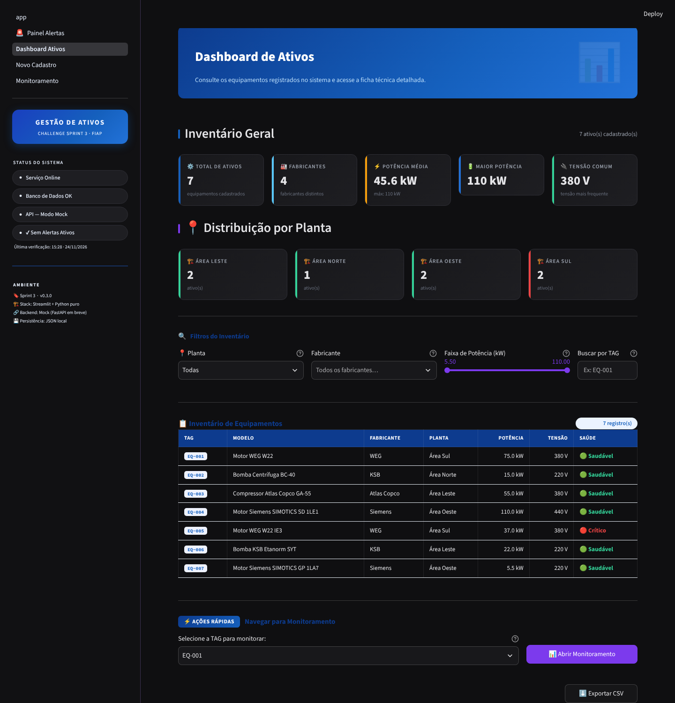
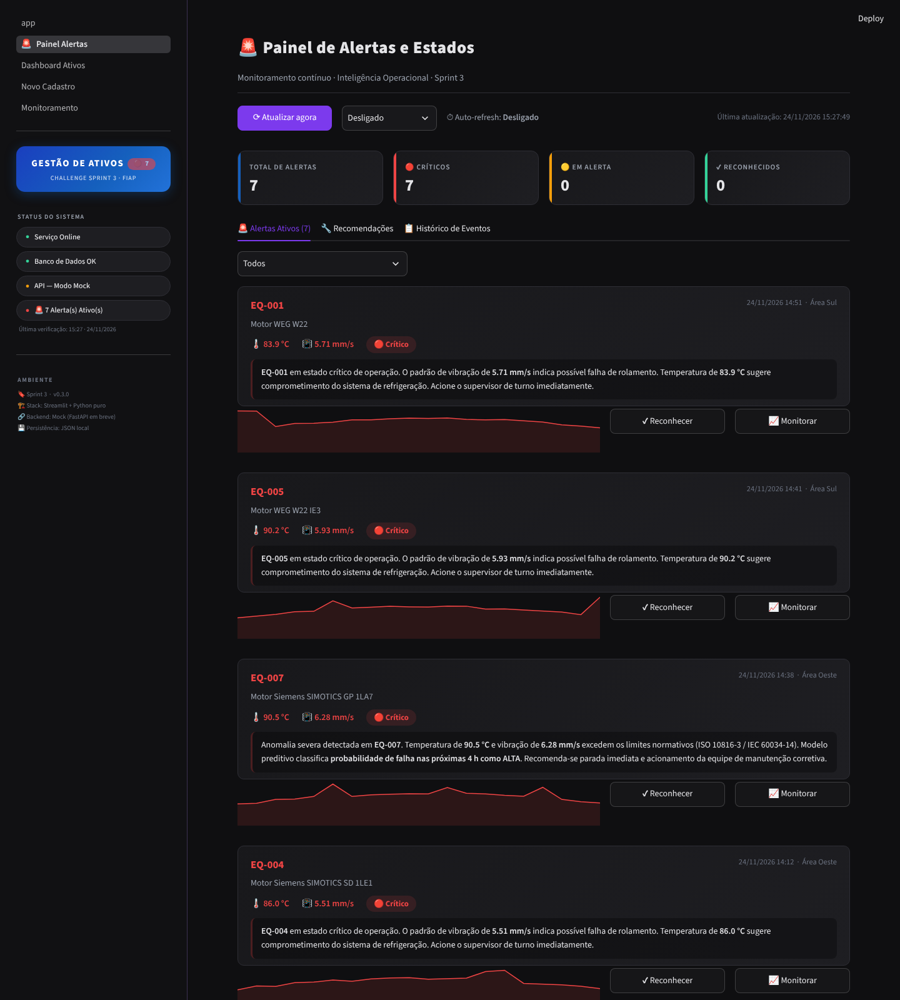
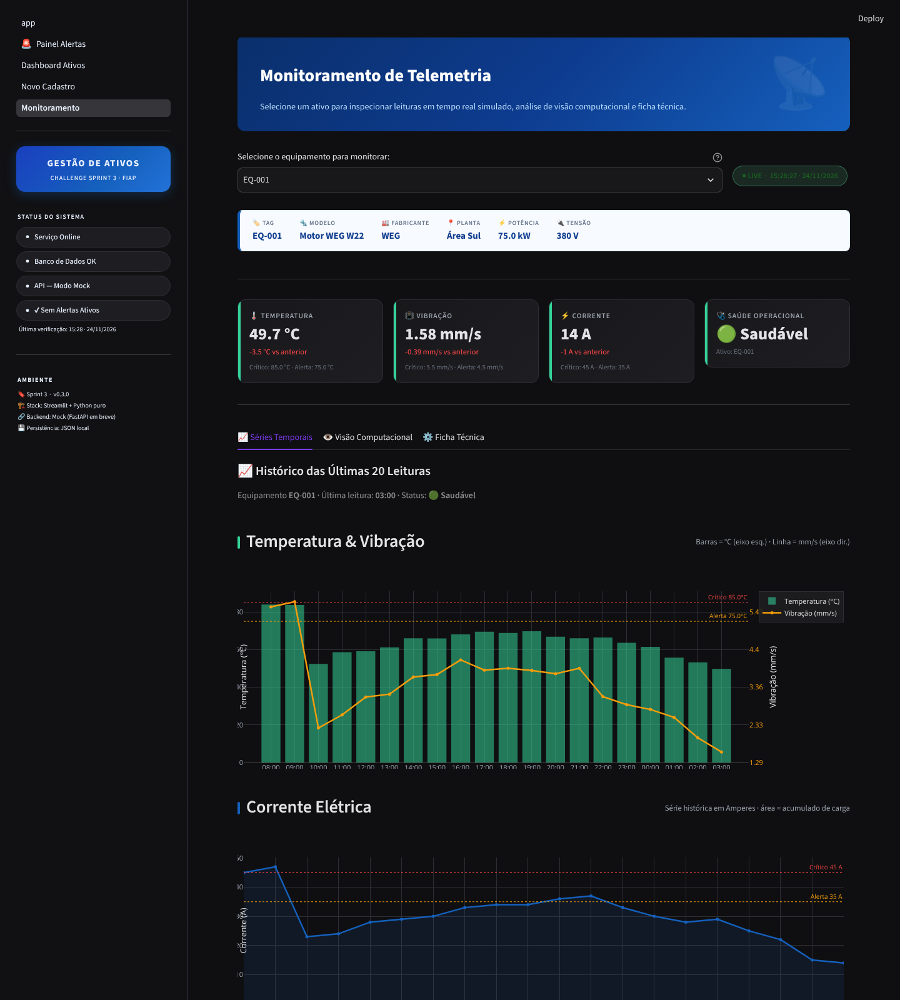
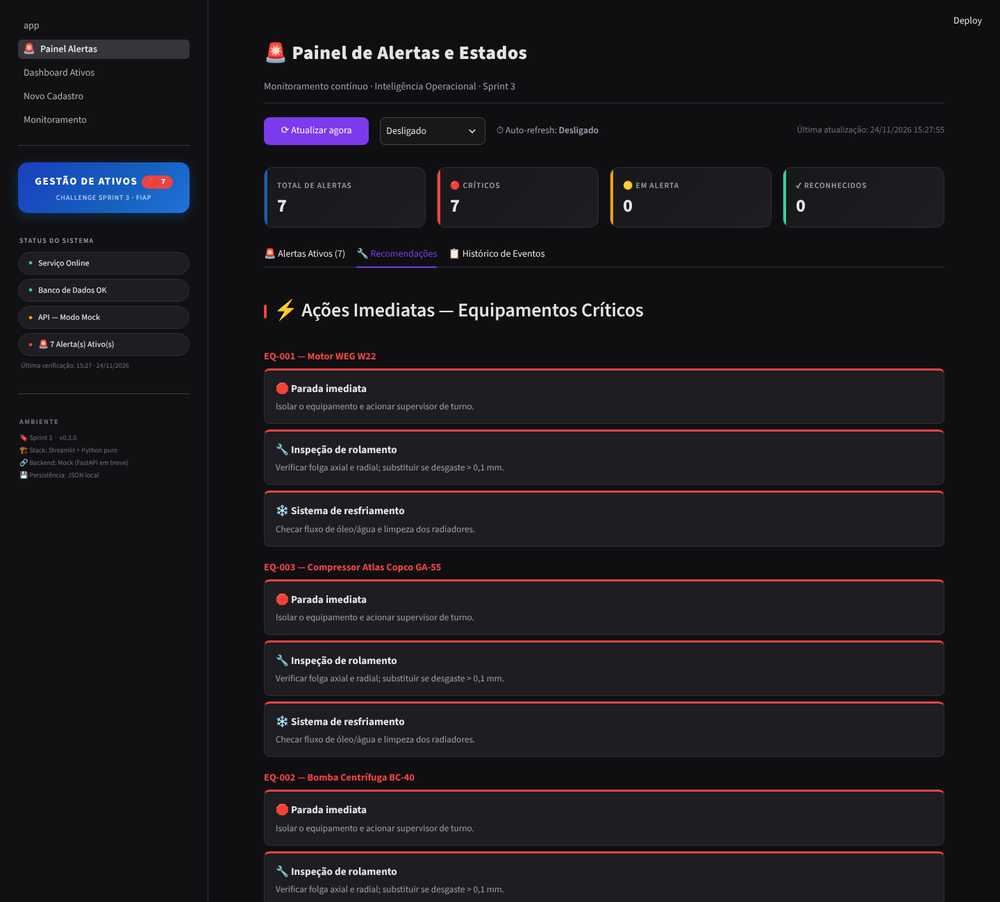
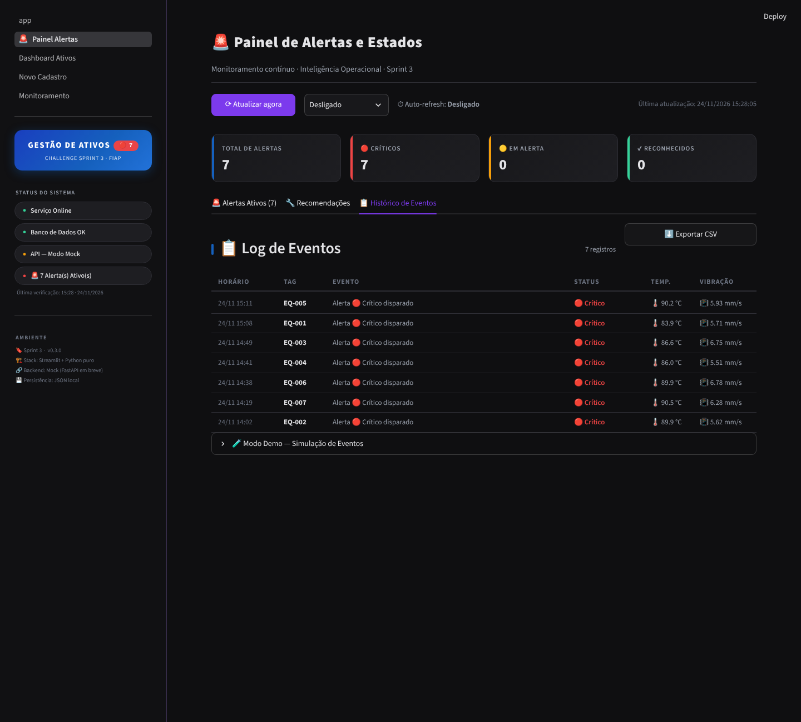
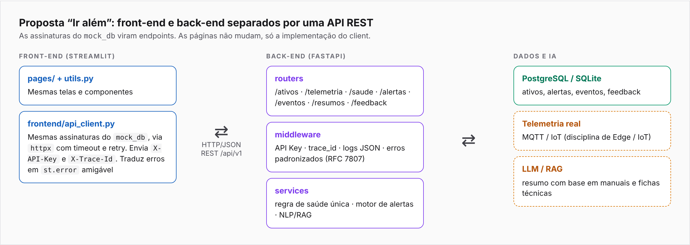

# Documentação Final: Gestão de Ativos Industriais

**Challenge Sprint 4 · Front-End · FIAP · 2026 · Challenge Forzy**

| Integrante | RM |
|:---|:---|
| Augusto Oliveira Codo de Sousa | RM562080 |
| Felipe de Oliveira Cabral | RM561720 |
| Gabriel Tonelli Avelino Dos Santos | RM564705 |
| Vinícius Adrian Siqueira de Oliveira | RM564962 |
| Sofia Bueris Netto de Souza | RM565818 |

**Repositório:** <https://github.com/Tonelli2003/CS1-e-2-3-4-FrontEnd> (branch `CS4`)
**Stack:** Python 3.11+ · Streamlit ≥ 1.49 · Plotly ≥ 5.20 · sem pandas e sem numpy

---

## Sumário

1. [Introdução](#1-introdução)
2. [Evolução desde a Sprint 3](#2-evolução-desde-a-sprint-3)
3. [Diferenciais e Resultados](#3-diferenciais-e-resultados)
4. [Pendências, Justificativas e Melhorias Futuras](#4-pendências-justificativas-e-melhorias-futuras)
5. [Ir além: arquitetura de produção (proposta)](#5-ir-além-arquitetura-de-produção-proposta)
6. [Conclusão](#6-conclusão)

---

## 1. Introdução

O Challenge Forzy pede uma solução para **monitorar ativos industriais** (motores, bombas e compressores) e **apoiar a decisão da manutenção** antes que uma falha vire parada de linha. Na disciplina de Front-End, o grupo construiu a camada de apresentação dessa solução em Streamlit, em três incrementos:

| Sprint | Entrega | Versão |
|:---|:---|:---:|
| 1 | Cadastro técnico do ativo (formulário validado) e landing page | v0.1.0 |
| 2 | Dashboard de inventário por planta, coluna de saúde, Monitoramento com séries temporais Plotly, design system (`PALETTE`, `kpi_card`) | v0.2.0 |
| 3 | Painel de Alertas e Estados: alertas priorizados, resumo NLP simulado, recomendações, histórico de eventos e atualização por botão ou timer | v0.3.0 |

Este documento consolida o projeto. Ele descreve o estado entregue, os resultados e as limitações encontradas, e propõe os próximos passos. As evidências (prints, trechos de código e diagramas) estão em [`docs/img/`](img/). Os prints foram capturados executando as versões da Sprint 2 e da Sprint 3 em 24/11/2026.

---

## 2. Evolução desde a Sprint 3

### 2.1 Ponto de partida: estado entregue na Sprint 3

A Sprint 3 foi entregue no commit `38998b6` (*"Sprint 3: Painel de Alertas e Estados Operacionais"*, 27/08/2026), branch `CS3`. Na entrega, a aplicação tinha:

- **4 páginas + home**: `0_🚨_Painel_Alertas`, `1_Dashboard_Ativos`, `2_Novo_Cadastro` e `3_Monitoramento`.
- **Camada de dados simulada** em `backend/mock_db.py` (466 linhas), com uma API pública consumida pelas páginas.
- **Design system** em `utils.py` (418 linhas), com 9 componentes reutilizáveis.
- Cerca de **3.100 linhas** de Python, contra cerca de 2.790 na Sprint 2.



### 2.2 O que mudou entre a entrega da Sprint 3 e a apresentação final

> **Transparência:** a Sprint 4 não teve desenvolvimento novo de funcionalidades, conforme o enunciado (*"em vez de uma nova entrega de código"*). O código funcional da apresentação final é o da Sprint 3. Nesta sprint o trabalho foi de **consolidação**, descrito abaixo.

| # | Tipo | O que foi feito na Sprint 4 | Evidência |
|:---:|:---|:---|:---|
| 1 | Qualidade | **Auditoria funcional**: a aplicação foi executada página por página e os resultados foram comparados entre as telas. Isso revelou 6 inconsistências que não apareciam olhando cada tela isoladamente (seção 4.1) | Prints nas seções 3 e 4 |
| 2 | Qualidade | **Verificação por script** do critério de saúde para os 7 ativos (Painel × Dashboard × Monitoramento) | Tabela na seção 4.1, item P1 |
| 3 | Documentação | Criação desta documentação (`docs/DOCUMENTACAO_FINAL.md`) com prints e diagramas de arquitetura, jornada e proposta | `docs/` |
| 4 | Documentação | README corrigido: removido o link `https://127.0.0.1:57744/...webp` (endereço local que não abre para outras pessoas), incluída a seção da Sprint 4 e o link para esta documentação | `README.md` |
| 5 | Planejamento | Backlog priorizado de correções e a proposta de arquitetura com API REST (seções 4 e 5) | Seções 4 e 5 |

### 2.3 Rastreabilidade: o que a Sprint 3 acrescentou sobre a Sprint 2

Como a correção é por comparação, a tabela abaixo mostra arquivo por arquivo o que mudou no último incremento de código, ou seja, o que compõe a versão final.

| Arquivo | Sprint 2 | Sprint 3 (versão final) |
|:---|:---|:---|
| `pages/0_🚨_Painel_Alertas.py` | não existia | **Novo** (357 linhas): KPIs, 3 abas (Alertas, Recomendações, Histórico), filtro por status, botão "Atualizar agora", timer 15/30/60 s, exportação CSV e Modo Demo |
| `backend/mock_db.py` | CRUD, telemetria e `avaliar_saude` | + persistência em `assets.json` · `gerar_alertas` · `gerar_resumo_nlp` · `simular_novo_alerta` · `reconhecer_alerta` · `sincronizar_alertas` · `contar_alertas_ativos` · `time.sleep(1)` removido do cadastro |
| `utils.py` | `kpi_card`, `status_card`, `section_header` | + `alert_card` · `recommendation_card` · `event_row` · `render_sparkline` · badge de alertas na sidebar · `html.escape` nos cards |
| `app.py` | 4 KPIs (o último era "Status API: Mock") | 5 KPIs com **Alertas Críticos** e **Em Alerta** + faixa de chamada para ação (`st.error` / `st.warning` / `st.success`) |
| `pages/1_Dashboard_Ativos.py` | `st.dataframe` com `column_config` | Tabela HTML com cor semântica na coluna Saúde |
| `pages/2_Novo_Cadastro.py` | validação de campos vazios | + **rejeição de TAG duplicada** e gravação automática em JSON |
| `requirements.txt` | `streamlit>=1.33.0` | `streamlit>=1.49.0` (exigido por `@st.fragment(run_every=...)` e `width='stretch'`) |

**Antes e depois: Home**

| Sprint 2 | Sprint 3 (final) |
|:---:|:---:|
|  |  |
| KPI genérico "Status API: Mock Ativo", 3 módulos | KPIs de alertas críticos e em alerta, faixa vermelha de ação, 4 módulos |

**Trecho de código: timer não bloqueante (Sprint 3)**

```python
# pages/0_🚨_Painel_Alertas.py
if intervalo > 0:
    @st.fragment(run_every=intervalo)      # reexecuta só o fragmento, sem time.sleep()
    def _auto_tick():
        novo = simular_novo_alerta()
        if novo:
            st.toast(f"⚡ Timer ({intervalo}s): novo alerta em **{novo['tag']}** ...", icon="🔴")
        st.rerun(scope="app")              # atualiza KPIs e lista
    _auto_tick()
```

**Trecho de código: TAG duplicada (Sprint 3)**

```python
# pages/2_Novo_Cadastro.py
tag_normalizada = tag.strip().upper()
tags_existentes = {eq["TAG"] for eq in get_equipamentos()}
# rejeita o cadastro se tag_normalizada já existir
```

---

## 3. Diferenciais e Resultados

### 3.1 Diferenciais técnicos e de UX

| Diferencial | Como aparece no projeto |
|:---|:---|
| **Cores semânticas com fonte única** | `PALETTE` em `utils.py`: `critical #EF4444`, `alert #F59E0B`, `safe #34D399`. Nenhuma página do design system define cor própria. Os limites seguem normas: Crítico acima de 85 °C ou 5,5 mm/s (ISO 10816-3), Alerta acima de 75 °C ou 4,5 mm/s (IEC 60034-14). |
| **Componentização** | 9 componentes em `utils.py` reaproveitados entre páginas. O `alert_card` devolve `"reconhecer"` ou `"monitorar"`, e a página decide o que fazer com isso: o componente não conhece regra de negócio. |
| **Desacoplamento UI × dados** | As páginas importam só funções públicas do `mock_db`. Na Sprint 3, o acesso direto de `utils.py` à chave privada `_s3_alertas_ativos` foi trocado por `contar_alertas_ativos()`. |
| **IA/NLP preparada para integração** | `gerar_resumo_nlp(tag, status, temp, vib)` é chamada no momento da renderização. Os alertas já trazem os campos `confianca`, `score_anomalia` e `modelo_versao` (`"mock-v1.0"`). Trocar por um LLM real altera só o corpo da função. |
| **Rastreabilidade** | Cada alerta tem ID único (`ALT-EQ-001-<uuid8>`). Disparos, alertas simulados e reconhecimentos entram no histórico com data e hora, e o histórico pode ser exportado em CSV. |
| **Navegação cruzada** | "📈 Monitorar" no alerta grava `tag_navegacao` e chama `st.switch_page`, abrindo o Monitoramento já com o ativo selecionado. |
| **Zero-dependency de dados** | Sem pandas e sem numpy: só `list`, `dict`, `csv`, `math` e `random`. O Plotly só desenha. |
| **Segurança básica** | `html.escape` nos campos digitados pelo usuário exibidos em `alert_card` e `event_row`. |

### 3.2 Jornada do usuário: monitorar → receber alerta → agir



| Etapa | Evidência |
|:---|:---|
| **Monitorar**: inventário com saúde por ativo |  |
| **Receber alerta**: alertas priorizados, resumo NLP e sparkline |  |
| **Investigar**: séries temporais com limites normativos |  |
| **Agir**: recomendações por urgência |  |
| **Registrar**: histórico de eventos exportável |  |

### 3.3 Como a solução atende ao Challenge Forzy

| Necessidade do problema | Resposta da solução |
|:---|:---|
| Saber **quais ativos existem** e onde estão | Cadastro técnico com TAG única, planta, potência e tensão. Dashboard com distribuição por planta e filtros. |
| Enxergar o **comportamento** do ativo | Monitoramento com 20 leituras, temperatura e vibração em dois eixos Y, corrente e linhas de limite. |
| Ser **avisado** de anomalias sem procurar | Badge na sidebar, faixa de chamada para ação na Home, toast em tempo real e timer automático. |
| **Decidir** o que fazer | Resumo em linguagem natural e recomendações separadas em "Ações Imediatas" (críticos) e "Ações Planejadas" (em alerta). |
| **Prestar contas** da ação | Reconhecimento de alerta com registro no histórico e exportação em CSV. |

---

## 4. Pendências, Justificativas e Melhorias Futuras

### 4.1 Problemas encontrados na auditoria (Sprint 4)

**P1. Critérios de saúde diferentes entre as telas (alta prioridade).** O Painel de Alertas classifica o ativo pelo **pico da série inteira**, enquanto o Dashboard e o Monitoramento usam **a última leitura**. Resultado medido por script sobre os dados simulados:

| TAG | Painel de Alertas (pico) | Dashboard e Monitoramento (última leitura) |
|:---:|:---:|:---:|
| EQ-001 | 🔴 Crítico | 🟢 Saudável |
| EQ-002 | 🔴 Crítico | 🟢 Saudável |
| EQ-003 | 🔴 Crítico | 🟢 Saudável |
| EQ-004 | 🔴 Crítico | 🟢 Saudável |
| EQ-005 | 🔴 Crítico | 🔴 Crítico |
| EQ-006 | 🔴 Crítico | 🟢 Saudável |
| EQ-007 | 🔴 Crítico | 🟢 Saudável |

Os prints da seção 3.2 mostram o efeito: EQ-001 aparece crítico no Painel e "🟢 Saudável" no Monitoramento.
*Por que ficou assim:* a troca para o pico foi feita na Sprint 3 para que o estado 🟡 Alerta pudesse aparecer, mas só no Painel. As outras telas não foram ajustadas por falta de prazo.
*Efeito colateral:* como todo pico simulado passa dos limites críticos, a carga inicial nunca mostra itens "Em Alerta" (KPI = 0). O estado amarelo só aparece pelo botão ou pelo timer.

**P2. Badge da sidebar desatualizado.** Em `app.py`, a sidebar é desenhada (linha 53) **antes** de `gerar_alertas()` (linha 62). Na primeira abertura, a Home mostra "7 críticos" no KPI e "✓ Sem Alertas Ativos" na sidebar (print da Home). Quem abre direto pela URL do Dashboard ou do Monitoramento também vê o badge zerado.

**P3. Resumo NLP muda a cada interação.** `gerar_resumo_nlp` usa `random.choice` em cada renderização, então o texto do mesmo alerta muda a cada clique. O resumo deveria ser gerado uma vez e guardado no próprio alerta.

**P4. Escape de HTML incompleto.** A tabela HTML do Dashboard insere `TAG` e `Modelo` sem `html.escape`, ao contrário de `alert_card`. Um cadastro com `<` no modelo quebra a tabela.

**P5. Vazamento de camada no Modo Demo.** Os botões "Reconhecer Todos" e "Limpar Alertas" alteram `st.session_state["_s3_alertas_ativos"]` diretamente, sem passar pela API do `mock_db`. Além disso, "Reconhecer Todos" não grava nada no histórico, o que quebra a rastreabilidade.

**P6. Detalhes de interface.**
- `ttl=30` em `obter_telemetria_historica` não produz dado novo, porque a semente é fixa por TAG. A série recalculada é idêntica (verificado). Na prática, o "tempo real" vem apenas de `simular_novo_alerta`.
- Restam estilos do tema claro no tema escuro: faixa branca da ficha no Monitoramento e chips `#EEF2FF` na tabela.
- O delta de temperatura mostra queda em vermelho ("-3.5 °C vs anterior"), mas para temperatura a queda é boa.
- A página principal aparece como "app" no menu.
- O emoji no nome do arquivo `0_🚨_Painel_Alertas.py` se corrompe ao compactar o projeto em zip no Windows (`0_#L01f6a8_...`).

### 4.2 Pendências de escopo (planejadas, não implementadas)

| Pendência | Situação | Por que não foi feito |
|:---|:---|:---|
| Back-end FastAPI real | Mock em `session_state` + JSON | Depende da disciplina de back-end e de infraestrutura. Foi decisão de escopo manter o front-end testável sozinho. |
| Telemetria real de sensores | Série sintética determinística | Depende de hardware e IoT, fora do escopo de Front-End. |
| NLP/LLM real | 5 modelos de texto | Exige chave de API, custo e avaliação de alucinação. A interface já está pronta (seção 3.1). |
| OCR real da placa | Dados `dados_ocr` fixos | Visão computacional fica em outra disciplina. |
| Autenticação e perfis | Inexistente | Prazo. Faz sentido junto com a API (seção 5). |
| Persistência multiusuário | `assets.json` local | Em deploy com disco efêmero (Streamlit Cloud) os dados se perdem. Os erros de I/O são ignorados com `except: pass`. |
| Testes automatizados | Nenhum | Prazo. A Sprint 3 também removeu docstrings que existiam na Sprint 2. |

### 4.3 Próximos passos priorizados

| Prioridade | Ação | Resolve | Esforço |
|:---:|:---|:---|:---:|
| 1 | Criar `status_atual(tag)` no `mock_db` com **uma regra só** (por exemplo, média das 3 últimas leituras) e usá-la nas 3 telas | P1 | ~2 h |
| 2 | Em `app.py`, chamar `gerar_alertas()` antes de `aplicar_design_fixo_sidebar()`, e chamar `init_db()` + `gerar_alertas()` dentro de `aplicar_design_fixo_sidebar()` | P2 | ~30 min |
| 3 | Gerar o resumo NLP ao criar o alerta e guardar em `alerta["resumo"]` | P3 | ~30 min |
| 4 | `html.escape` na tabela do Dashboard. Funções `reconhecer_todos()` e `limpar_alertas()` no `mock_db`, com registro no histórico | P4, P5 | ~1 h |
| 5 | Testes `pytest` para `avaliar_saude`, `gerar_alertas` e `reconhecer_alerta` (funções puras, fáceis de testar) | qualidade | ~2 h |
| 6 | Ajustes visuais: tema escuro uniforme, cor do delta por tipo de métrica, página sem emoji no nome do arquivo | P6 | ~2 h |
| 7 | Migração para API REST (seção 5) | escopo | 2–3 semanas |

---

## 5. Ir além: arquitetura de produção (proposta)

A API pública do `mock_db` foi desenhada para se tornar uma API HTTP. A proposta é manter as páginas como estão e trocar só a implementação, criando um `frontend/api_client.py` com **as mesmas assinaturas**.



### 5.1 Endpoints (mapeamento 1:1 com a API atual)

| Função atual (`mock_db`) | Endpoint FastAPI |
|:---|:---|
| `get_equipamentos()` | `GET /api/v1/ativos?planta=` |
| `adicionar_equipamento(d)` | `POST /api/v1/ativos` (409 se a TAG já existir) |
| `obter_telemetria_historica(tag, n)` | `GET /api/v1/ativos/{tag}/telemetria?limite=20` |
| `avaliar_saude(...)` → `status_atual(tag)` | `GET /api/v1/ativos/{tag}/saude` |
| `gerar_alertas()` | `GET /api/v1/alertas?status=critico,alerta` |
| `reconhecer_alerta(id)` | `POST /api/v1/alertas/{id}/reconhecimento` |
| `obter_historico_eventos(limite)` | `GET /api/v1/eventos?limite=50` |
| `gerar_resumo_nlp(...)` | `POST /api/v1/alertas/{id}/resumo` |
| *(novo)* feedback da IA | `POST /api/v1/resumos/{id}/feedback` `{"util": true}` |

### 5.2 Requisitos transversais

- **Autenticação por API Key:** o cabeçalho `X-API-Key` é validado por uma dependência FastAPI. No front-end, a chave fica em `.streamlit/secrets.toml`, que já está no `.gitignore`.
- **Observabilidade:** o front-end gera `X-Trace-Id` (uuid4) por ação do usuário. A API devolve o mesmo valor e o registra em log JSON. Assim, um erro relatado na tela leva à linha de log correspondente.
- **Tratamento amigável de erros:** respostas no formato RFC 7807 (`{"title", "detail", "trace_id"}`). O client converte timeout em `st.warning("Serviço indisponível, exibindo últimos dados")` e erro 409 em `st.error("TAG já cadastrada")`.
- **Feedback em respostas de IA:** botões 👍/👎 no `alert_card` enviam o feedback com `trace_id` e `modelo_versao`, o que permite avaliar a qualidade do resumo.

### 5.3 Plano de migração

1. Criar `api_client.py` com as mesmas assinaturas, delegando ainda para o `mock_db`. Comportamento inalterado.
2. Subir a FastAPI com os endpoints de leitura (`/ativos`, `/telemetria`, `/alertas`) e apontar o client para ela.
3. Migrar as escritas (cadastro e reconhecimento) e trocar `assets.json` por banco de dados.
4. Adicionar API Key, trace_id e o endpoint de feedback.
5. Conectar o resumo a um LLM com RAG sobre manuais e fichas técnicas.

---

## 6. Conclusão

Em três sprints, o grupo entregou uma aplicação navegável que cobre a jornada pedida pelo Challenge Forzy: cadastrar o ativo, monitorá-lo, receber o alerta, entender a situação em linguagem natural e registrar a ação. Os pontos fortes são o design system com cores semânticas centralizadas, a componentização e o desacoplamento entre interface e dados, que deixa o caminho aberto para a integração com API e IA.

A auditoria da Sprint 4 mostrou que o próximo passo mais valioso não é uma funcionalidade nova, e sim **coerência**: uma única regra de saúde compartilhada por todas as telas, o badge sincronizado e o resumo estável. São correções pequenas (seção 4.3, itens 1 a 4, cerca de 4 horas no total) que deixam a solução consistente antes da migração para a arquitetura de produção proposta na seção 5.

---

*Gestão de Ativos · Challenge Sprint 4 · FIAP · 2026*
